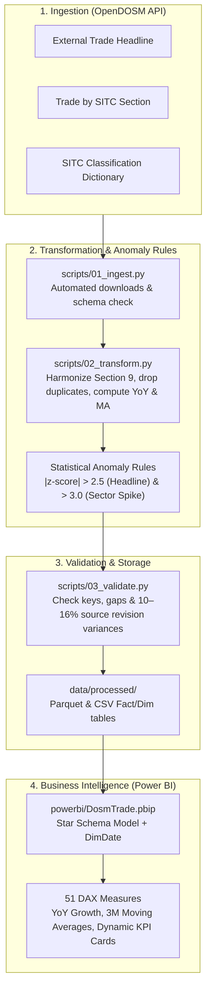

# DOSM Trade Engine 🇲🇾📊


[](https://www.python.org/)
[](https://powerbi.microsoft.com/)
[](https://open.dosm.gov.my)
[](https://parquet.apache.org/)

Monthly Malaysian merchandise trade statistics from [OpenDOSM](https://open.dosm.gov.my) (Jan 2000 – Aug 2026, 320 months, 3,190 month-by-sector rows), cleaned and flagged for statistical anomalies in Python, then modelled into a **star schema with 51 DAX measures** in Power BI.

---

## ⚡ Architecture & Pipeline Flow



---

## 🚀 Running the Pipeline

```bat
run_pipeline.bat        (Windows)
./run_pipeline.sh       (Git Bash / Linux / macOS)
```

First-time setup, if `.venv` does not exist yet:

```bash
python -m venv .venv
.venv\Scripts\python.exe -m pip install -r requirements.txt
```

| Step | Script | Execution Details |
|---|---|---|
| **1. Ingest** | `scripts/01_ingest.py` | Downloads the three OpenDOSM tables to `data/raw/`, with HTTP retries and schema assertions. |
| **2. Transform** | `scripts/02_transform.py` | Cleans sections 0–9, filters aggregate double-counts, and builds fact/dim tables in `data/processed/` (parquet + CSV). |
| **3. Validate** | `scripts/03_validate.py` | Checks keys, gaps and totals; flags anomalies and exits non-zero if a check fails. |

---

## 🗄️ Processed Tables & Data Model

All currency values are in **RM million**.

* **`fact_trade_headline`**: One row per month: exports, imports, balance, YoY %, 3-month moving averages, and `is_export_anomaly` (`|z-score of exports YoY %| > 2.5`).
* **`fact_trade_sitc`**: One row per month and SITC section (0–9): exports, imports, trade balance, YoY %, and `is_sector_spike` (`|z-score of section exports YoY %| > 3.0`).
* **`dim_sitc`**: The 10 SITC sections with English and Malay descriptions (harmonized for Section 9).
* **`DimDate`**: Continuous calendar date table supporting time intelligence calculations.

---

## 📈 Power BI Model & DAX Architecture

Open `powerbi/DosmTrade.pbip` in Power BI Desktop and click **Refresh**. The model (star schema, date table, 51 DAX measures) and the *Trade Overview* report page are pre-built.

* **Dimensional Relationships:** Star schema linking `DimDate` and `dim_sitc` to headline and sectoral fact tables.
* **51 DAX Measures:**
  - **Time Intelligence:** Prior Year (PY), YoY Absolute Variance, YoY % Change.
  - **Trend Analysis:** 3-month rolling moving averages to smooth seasonal volatility.
  - **Dynamic Status Flags:** Anomaly alerts and latest-month headline cards.
* **Parameter Configuration:** The model reads CSVs from the directory specified in the `ProcessedFolder` parameter. If the project directory is moved, update it under **Transform data > Edit parameters**.

---

## 🔍 Data Source Nuances & Quality Audits

- **Double-Counting Avoidance:** The SITC endpoint contains an `overall` aggregated row per month; the transform drops it so sector totals are not double-counted.
- **Section 9 Metadata Harmonization:** The OpenDOSM dictionary defines sections 0–8 only. Because Section 9 exists in active trade records, the transform automatically injects its descriptions.
- **Source Revision Variance:** The headline table has been revised for 2024 onwards, whereas the SITC sectoral table follows a delayed revision schedule. Sector totals differ slightly from headline numbers in those months (gap is <1% except for imports in June and July 2024 at ~10% and 16%). The validation step verifies and reports this gap on every pipeline run.
- **Publication Lag:** The SITC sectoral table is published one month behind the headline table.
